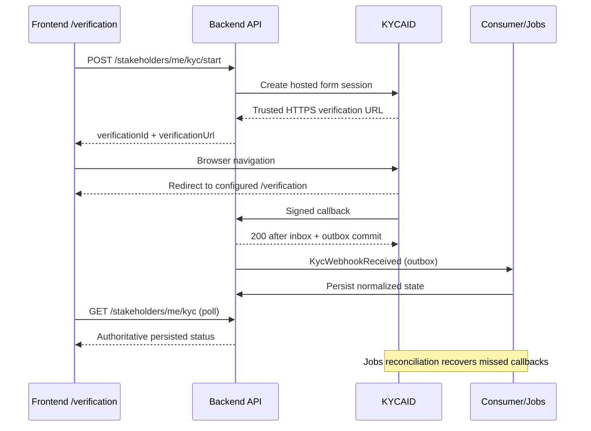
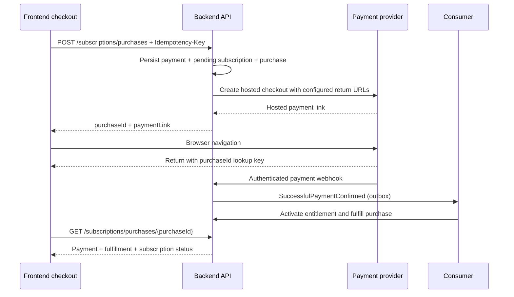

# Customer KYC and billing integration

This is the frontend handoff for CAF-FE-006 and CAF-FE-007. It describes implemented backend behavior, not
design fixtures. JSON uses the default ASP.NET Core camel-case serialization. Every authenticated request also
supplies the normal `X-Tenant-Id` header; actor and stakeholder identity come from the active session.

## Part A — CAF-FE-006 KYC

### Operations and authorization

| Operation | Authorization | Purpose |
| --- | --- | --- |
| `GET /api/v1/stakeholders/me/kyc` | `RequireActiveSession` | Read the authenticated stakeholder's authoritative persisted state. |
| `POST /api/v1/stakeholders/me/kyc/start` | `RequireActiveSession` | Start, resume or restart the authenticated stakeholder's verification. |

Neither route accepts a stakeholder ID. Tenant and stakeholder ownership are derived from the authenticated
actor, so another stakeholder's attempt cannot be selected.

The status response is:

```json
{
  "verificationId": "019...",
  "provider": "kycaid",
  "status": "Pending",
  "isVerified": false,
  "verificationUrl": "https://forms.kycaid.com/...",
  "startedAtUtc": "2026-11-28T12:00:00Z",
  "submittedAtUtc": null,
  "completedAtUtc": null
}
```

With no attempt, `verificationId`, `provider`, URL and timestamps are null and `status` is `NotStarted`.
The start response contains `verificationId`, `provider`, `status` and `verificationUrl`. Navigate only to the
backend-returned URL; never construct a provider URL or send provider credentials from the browser.

### Status and action mapping

| Backend status | Can start/restart | Poll status | Terminal attempt | Frontend meaning |
| --- | --- | --- | --- | --- |
| `NotStarted` | Yes | No | No attempt | Offer verification. |
| `Pending` | Yes; start resumes the URL or provisioning request | Yes after redirect/start | No | Session is being prepared or awaits user submission. Navigate when `verificationUrl` is non-null. |
| `InProgress` | No new form; start returns the existing attempt | Yes | No | Submission received; provider decision pending. |
| `Verified` | No | No | Yes | Verification completed. `isVerified` is authoritative stakeholder state. |
| `Rejected` | Yes | No until restarted | Yes | Show rejection and offer retry. |
| `Failed` | Yes | No until restarted | Yes | Show recoverable failure and offer retry. |
| `Expired` | Yes | No until restarted | Yes | Show expiry and offer retry. |

`Pending` with no URL can occur while provider session creation has an unknown outcome. Keep the page
recoverable and allow a later start retry; the backend's provisioning lease prevents duplicate provider forms.

### Redirect, callback and polling

Configure `Kyc:Kycaid:RedirectUrl` to the environment's authenticated `/verification` page, for example
`https://staging.example.com/verification`. The setting is backend-owned and environment-specific. Do not
accept a browser-supplied redirect. Development still needs a provider-acceptable public URL.



Poll while `Pending` or `InProgress`, with a client-side count/time bound and manual refresh. Browser return,
query parameters and form completion never mean verified. Signed callbacks and reconciliation apply the same
provider-normalized transitions; duplicate, late and out-of-order callbacks cannot regress a terminal attempt.

### Errors and limitations

| Outcome | HTTP response |
| --- | --- |
| Missing/invalid active session | `401` |
| Stakeholder record missing | `404` on start |
| Missing first or last name | `400` with a plain explanatory body |
| Already verified | `409` with a plain explanatory body |
| Provider disabled, unavailable, timed out, returned an untrusted URL, or session still being prepared | `503` with a plain explanatory body |

Pending/in-progress attempts are normally returned successfully rather than as a `409`. The KYC customer
errors do not currently have stable machine-readable codes. The API does not expose raw provider payloads,
applicant identifiers, credentials or documents.

## Part B — CAF-FE-007 subscriptions and billing

### Operations

| Operation | Authorization | Purpose |
| --- | --- | --- |
| `GET /api/v1/subscription-plans` | Anonymous | Active public plan catalogue. |
| `GET /api/v1/subscription-plans/{planId}/payment-providers?BillingAccountOwnerType=Stakeholder` | Active session | Eligible providers for the actor, plan currency and subscription intent. |
| `POST /api/v1/subscriptions/purchases` | Active session + `Idempotency-Key` UUID | Persist and initiate a server-priced purchase. |
| `GET /api/v1/subscriptions/purchases/{purchaseId}?BillingAccountOwnerType=Stakeholder` | Active session | Owner-scoped payment, fulfillment and subscription status. |
| `GET /api/v1/subscriptions/current?BillingAccountOwnerType=Stakeholder` | Active session | Current pending/active entitlement. |
| `GET /api/v1/subscriptions/billing-history?BillingAccountOwnerType=Stakeholder&Page=1&PageSize=20` | Active session | Owner-scoped, newest-first payment history. |
| `POST /api/v1/subscriptions/current/cancellation-at-period-end` | Active session | Idempotently schedule period-end cancellation. |

Plans expose `id`, stable `code`, `name`, optional `description`, `features`, `prices[]` (`billingInterval`,
whole-minor-unit `price`), `currencyId` and `currencyCode`. Only active plans are listed. The frontend must not
calculate the charge or infer provider eligibility.

Eligible providers expose `id`, `name`, `paymentMethodType` and `supportsRecurringPayments`. An inactive or
unknown plan returns `404`; invalid owner input returns `400`.

### Purchase and hosted checkout

Send a stable UUID once per user checkout action:

```http
POST /api/v1/subscriptions/purchases
Idempotency-Key: 019...
Content-Type: application/json

{
  "planId": "019...",
  "billingInterval": "Monthly",
  "paymentProviderId": "019...",
  "billingAccountOwnerType": "Stakeholder",
  "autoRenew": true
}
```

The backend resolves price and currency, persists payment/subscription/purchase correlation, and then invokes
the provider. The response includes `subscriptionId`, `purchaseId`, `merchantReference`, `paymentStatus`,
provider fields, expiry, `paymentMethodType`, and provider-neutral `instructionFields`. For `PaymentLink`,
navigate only to `instructionFields.paymentLink`.

Exact retries with the same key return the original purchase. Reusing a key for a different request or buying
against an existing/reserved entitlement returns `409` Problem Details. Both conflicts currently share no
stable error code. Invalid/inactive plan, interval, provider or currency combinations fail through the existing
`400` validation/error contract. Initiation never activates the subscription.

For Bachs, configure separate wallet and subscription return URLs. The backend appends `purchaseId` to both
subscription success and cancellation URLs. Treat it only as a lookup key. If a browser loses the value, retain
the `purchaseId` from the purchase response locally. The owner-scoped status endpoint returns `404` for another
owner.



### Purchase status and polling

The response separates raw `paymentStatus`, raw `subscriptionStatus`, and `fulfillmentStatus` from normalized
`status`. Poll only while `shouldContinuePolling` is true:

| Normalized status | Meaning | Poll |
| --- | --- | --- |
| `PurchaseInitiated`, `PaymentPending` | Provider initiation/payment is pending. | Yes |
| `PaymentSucceededFulfillmentPending` | Money confirmed; async activation is pending. | Yes |
| `SubscriptionActive`, `SubscriptionScheduled` | Entitlement is available/scheduled. | No |
| `PaymentFailed`, `PaymentCancelled`, `PaymentExpired`, `PaymentUnderpaid` | Payment concluded unsuccessfully. | No |
| `SubscriptionCancelled`, `SubscriptionExpired` | This purchase's entitlement ended. | No |
| `FulfillmentBlocked` | Payment succeeded but activation needs administrative resolution. | No |

Use a client-side poll bound, preserve the last confirmed state on network error, and offer manual refresh.
Provider redirects and query parameters never establish payment success.

### Current subscription, history and cancellation

Current subscription returns `404` when no pending/active subscription exists. Otherwise it includes plan ID,
code/name/price/currency, `billingInterval`, raw `status`, display-oriented `lifecycleStatus`, paid period
boundaries, `nextBillingAtUtc`, `autoRenew`, `cancelAtPeriodEnd`, and cancellation timestamps.
`lifecycleStatus` may be `PastDue` while the domain status remains `Active`. Cancellation scheduled at period
end remains active through `currentPeriodEndUtc`; `nextBillingAtUtc` becomes null.

Billing history is page-number/page-size paginated (`1..100`), ordered by `(createdAtUtc, paymentTransactionId)`
descending, and combines initial purchase and renewal payments. Rows include authoritative amount/currency,
payment status/provider, merchant reference, dates and period boundaries when known.

Cancellation body:

```json
{ "billingAccountOwnerType": "Stakeholder" }
```

The response is `{ "found": true, "changed": true, "entitledUntilUtc": "..." }`. A repeat is successful with
`changed: false`. There is no customer immediate cancellation, resume, upgrade, downgrade, proration or refund.

### Known limitations

- Billing history has no status/date filters, export, purchase-detail link, invoice ID or receipt ID.
- Invoices and receipts are a separate backend capability and remain deferred.
- Current subscription does not return historical cancelled/expired subscriptions; use billing history.
- Bachs cancellation is observed authoritatively through provider verification/reconciliation; the return page
  may temporarily continue to report `PaymentPending`.
- The API reports recurring capability separately. The frontend should not promise automatic renewal for a
  provider with `supportsRecurringPayments: false`.
- Conflict responses do not yet expose stable machine-readable codes.

## Reconciliation report

| Requirement | Existing backend support | Changes made | Remaining limitation | Frontend impact |
| --- | --- | --- | --- | --- |
| Customer KYC status/start (GAP-017-017) | Already supported with owner-scoped status, hosted URL, callbacks and reconciliation. | Canonical `/verification` return configuration and status/action/polling contract documented. | Stable KYC error codes are absent; environment configuration is required. | CAF-FE-006 can integrate independently and must poll backend state. |
| KYC duplicate/restart behavior | Already supported by database active-attempt uniqueness, provisioning lease and terminal-attempt restart rules. | No code change. | Provider outage remains recoverable `503`. | Reuse start; no restart endpoint. |
| Public plans and provider eligibility | Already supported; backend owns price/currency and enabled provider combinations. | Current multi-price contract documented. | Recurring capability is advisory to the client. | Render backend data; do not hardcode price/provider rules. |
| Idempotent subscription purchase | Already supported with persisted correlation and request fingerprint. | No contract-breaking change. | `409` reasons lack stable codes. | Persist one UUID per checkout action. |
| Hosted return correlation (GAP-017-025 subset) | Purchase ID/status route already existed, but Bachs return URLs were global and uncorrelated. | Added intent-specific Bachs return URLs and backend-appended `purchaseId` for subscription success/cancel returns. | Return is still not proof; Bachs cancellation may remain pending until reconciliation. | Return routes can recover status without relying only on browser storage. |
| Purchase/payment/fulfillment lifecycle | Already supported and deliberately separate. | Lifecycle/polling mapping documented. | No event timeline endpoint. | Show payment received separately from subscription active. |
| Current subscription and cancellation | Already supported with period boundary and repeated-request safety. | No code change. | No resume/plan change/immediate customer cancellation. | Use backend dates and lifecycle fields. |
| Billing history (GAP-017-025) | Already supported with owner-scoped pagination and deterministic ordering. | Supported contract documented. | Filters, export, row purchase linking and billing documents remain intentionally deferred. | Build only the paginated table and document limitations. |
| Payment/subscription async safety | Already supported by provider verification, transactional outbox, message inbox and state-checked handlers. | No architectural change. | Live provider behavior is not exercised by automated tests. | Poll and tolerate delayed activation. |

Verdict: CAF-FE-006 is **READY WITH CONFIGURATION** because the API and lifecycle are complete but each
environment must set a valid KYCAID return URL and credentials. CAF-FE-007 is **READY WITH CONFIGURATION**
because customer contracts are complete and Bachs now supports intent-specific correlated return routes, but
provider credentials, webhook registration and public return URLs remain deployment configuration.
